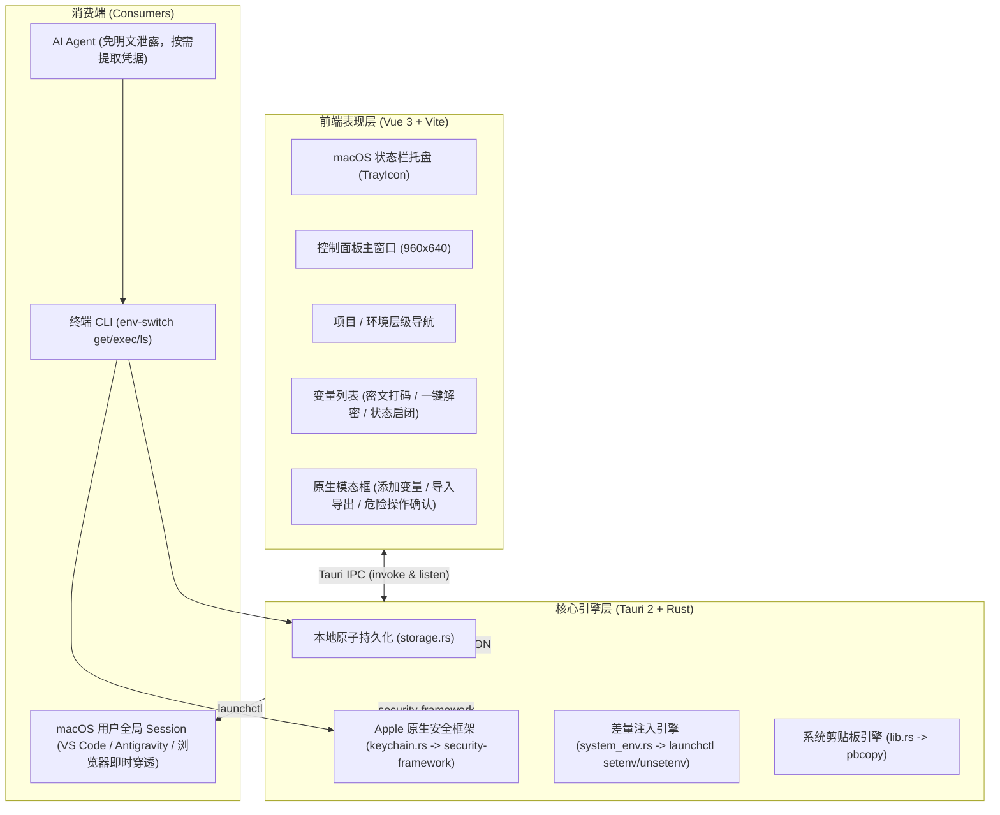

# EnvSwitch 项目交接文档 (Project Handoff)

> **文档目的**：供开发者或后续 AI Agent 在新会话中无缝接手 `env-switch` 的研发与迭代。涵盖架构设计、已落地成果、底层避坑指南（踩坑记录）、操作速查与下一阶段待办清单（Backlog）。

---

## 一、 项目概览与关键资产

| 属性 | 说明 / 路径 |
| :--- | :--- |
| **项目名称** | `env-switch`（macOS 菜单栏极简环境变量与凭证管理中枢） |
| **开源仓库** | [https://github.com/jasonvibe/env-switch](https://github.com/jasonvibe/env-switch) (Public, MIT License) |
| **本地代码路径** | `/Users/jason/Documents/开源项目/env-switch` |
| **已安装应用** | `/Applications/EnvSwitch.app`（体积 4.38 MiB，常驻 macOS 菜单栏） |
| **DMG 安装包** | `src-tauri/target/release/bundle/dmg/EnvSwitch_0.1.0_aarch64.dmg`（2.07 MiB） |
| **本地存储路径** | `~/Library/Application Support/com.jasonvibe.envswitch/store.json` |
| **系统钥匙串标识**| Service Name: `com.jasonvibe.envswitch` (基于 macOS Keychain) |
| **全局 CLI 工具** | `/Users/jason/.local/bin/env-switch` (已加入系统 `$PATH`) |
| **技术栈选型** | Tauri 2.0 + Vue 3 + TypeScript + Vite + Rust 2021 + Bun |

---

## 二、 架构设计与已交付功能 (Phase 1 MVP)

### 1. 核心架构拓扑


### 2. 已交付的核心能力清单
1. **四级数据模型体系**：`Workspace`（工作区） $\rightarrow$ `Project`（项目） $\rightarrow$ `Profile`（环境，如 Local/Dev/Prod） $\rightarrow$ `EnvVariable`（变量）。
2. **硬件级密文托管**：标记为 `is_secret` 的变量，其真实密码直接委托给 macOS Keychain 硬件加密，本地 `store.json` 的 `value` 绝不明文落盘。
3. **系统级 GUI 穿透注入**：点击「一键应用至系统」，底层自动差量计算并调用 `launchctl setenv` 注入全局用户 Session，同时自动清理旧环境独有变量，解决 GUI 软件与终端割裂痛点。
4. **原生状态栏常驻 (Tray)**：应用关闭后常驻后台，支持从托盘一键呼出控制面板、一键清除系统注入变量。
5. **.env 智能导入与完整解密导出**：支持常规及 `export` 前缀文本批量解析，对 `KEY`、`TOKEN`、`SECRET` 等自动预判为 Keychain 密文；导出时自动解密 Keychain 真实凭证并合并为标准 `.env`。
6. **伴生终端 CLI 工具 (`env-switch`)**：
   - `env-switch ls`：查看项目与环境结构树及系统生效状态。
   - `env-switch get <项目> <环境> <KEY>`：精准提取任意变量（含 Keychain 自动解密）。
   - `env-switch exec <项目> <环境> -- <cmd>`：子进程免污染运行，支持多项目多 Agent 并发互不干扰。
   - `env-switch apply` / `clear`：终端直接操控系统环境注入与清理。

---

## 三、 关键代码结构索引

```text
/Users/jason/Documents/开源项目/env-switch/
├── bin/
│   └── env-switch                     # 终端 CLI 脚本（Python，零第三方依赖，极速毫秒级响应）
├── src/                               # Vue 3 前端源码
│   ├── components/
│   │   ├── AddProfileModal.vue        # 新建环境配置弹窗（含色块选择器）
│   │   ├── AddProjectModal.vue        # 新建项目弹窗
│   │   ├── AddVariableModal.vue       # 新建/编辑变量弹窗（Keychain 密文切换）
│   │   ├── ConfirmModal.vue           # 原生防拦截危险确认弹窗（替代 window.confirm）
│   │   ├── ImportExportModal.vue      # .env 导入导出弹窗（敏感词预判与合并解密）
│   │   ├── Sidebar.vue                # 左侧栏（工作区/项目/环境树/系统状态卡片/清除按钮）
│   │   ├── Topbar.vue                 # 顶部栏（环境面包屑/一键系统生效/导入导出入口）
│   │   └── VariableTable.vue          # 主表格（搜索/筛选/开关/钥匙串解密眼睛/复制）
│   ├── api.ts                         # Tauri invoke 封装层
│   ├── store.ts                       # 响应式状态管理（useEnvStore）
│   ├── style.css                      # 现代 macOS 深色毛玻璃与系统字体样式系统
│   └── types.ts                       # TypeScript 接口定义
├── src-tauri/                         # Rust 后端源码
│   ├── Cargo.toml                     # 依赖与优化配置（启用 apple-native 特性）
│   ├── tauri.conf.json                # 窗口尺寸、标题与 bundle 配置
│   └── src/
│       ├── keychain.rs                # macOS Keychain 存取与单元测试
│       ├── models.rs                  # 核心数据模型与内置演示项目种子数据
│       ├── storage.rs                 # 本地 store.json 原子读写
│       ├── system_env.rs              # launchctl setenv/unsetenv 差量注入算法
│       ├── tray.rs                    # macOS 状态栏托盘与事件分发
│       └── lib.rs                     # Tauri 命令注册、.env 解析与 pbcopy 剪贴板实现
└── README.md                          # 完整的中英文开源项目说明与路线图
```

---

## 四、 核心避坑指南 (Gotchas & Critical Rules - 必读)

新 Agent 在接手开发时，**必须严格遵守以下经验，防止重蹈覆辙**：

### 1. 本地 Git 提交规范（极重要）
- 本机配置了全局 Git Hook：**提交备注必须使用中文**。
- 禁止使用纯英文 Commit（如 `fix: update bug` 会被 hook 拦截报错）。必须使用形如：`feat: 实现...`、`fix: 解决...`、`docs: 更新...`。

### 2. 包管理器必须使用 `bun`
- 系统环境中 Node.js 版本（v20.20.0）与全局 `pnpm` 存在版本冲突，但 `bun`（v1.3.11，路径 `/Users/jason/.bun/bin/bun`）运行极度稳定且速度极快。
- 所有前端安装、构建、启动均使用 `bun`，严禁擅自切换为 `pnpm` 或 `npm`。

### 3. macOS WebKit 对对话框的拦截（千万不要用 `window.confirm`）
- 在 Tauri 2 的 macOS WKWebView 中，系统默认静默屏蔽 `window.confirm()` 和 `window.alert()`，执行时会直接返回 `false` 且不弹出任何界面。
- **任何确认操作必须使用内置组件 [`ConfirmModal.vue`](file:///Users/jason/Documents/开源项目/env-switch/src/components/ConfirmModal.vue)**。

### 4. macOS 剪贴板权限限制（千万不要只依赖 `navigator.clipboard`）
- 内嵌 WebKit 对 `navigator.clipboard.writeText` 存在焦点与权限拦截，可能导致写入失败。
- 项目在 Rust 层实现了系统级命令 `copy_to_clipboard`（基于 macOS 内置 `pbcopy`），并在前端配置了三级降级策略（Rust `pbcopy` $\rightarrow$ `navigator.clipboard` $\rightarrow$ DOM `textarea`）。复制必须走该标准流程。

### 5. `keyring` crate 的 Feature Flags
- 在 `src-tauri/Cargo.toml` 中，`keyring` 必须带有 `features = ["apple-native"]`。若漏掉该特性，库会回退为静默 Mock 模式，导致密文无法落入 macOS Keychain。

### 6. Tauri 命令函数可见性
- 在 `src-tauri/src/lib.rs` 中，注册到 `tauri::generate_handler!` 的命令函数应声明为 `fn cmd_name(...)`，**不要**声明为 `pub fn cmd_name(...)`，否则在 Rust 2024 / Tauri 2 宏展开时会报命名空间重复导入冲突。

---

## 五、 后续研发任务清单 (Next Phase Backlog)

新会话中可直接启动以下功能迭代：

### 📌 迭代方向 A：工程化与本地项目目录联动 (Phase 2)
1. **绑定本地代码目录 (`repo_path`)**：
   - 在 Project 模型中已预留 `repo_path` 字段；
   - 支持为项目选择本地文件夹（如 `/Users/jason/Documents/ricent-gitlab`）；
   - 在控制面板支持一键生成 `.env.local` 到该目录，并自动扫描/更新该目录的 `.gitignore`（确保不会误提敏感配置）。
2. **终端 Shell 目录切换 Hook**：
   - 提供一行 `eval "$(env-switch hook zsh)"`；
   - 当终端 `cd` 进入绑定的项目目录时，自动提示或静默激活对应项目的环境变量。

### 📌 迭代方向 B：AI Agent 专用通道 (Phase 3 - MCP Server)
1. **内置 Model Context Protocol (MCP) Server**：
   - 在 `env-switch` 中内置轻量级 stdio 模式的 MCP Server；
   - Cursor、Claude Desktop、Antigravity 可直接将 `env-switch` 作为 MCP 工具接入；
   - Agent 发起 `get_environment_variable` 时，支持桌面端弹出授权通知（或静默授权白名单项目）。

### 📌 迭代方向 C：CI/CD 自动化构建与发布
1. **GitHub Actions 自动化流水线**：
   - 在 `.github/workflows/release.yml` 中配置基于 `tauri-action` 的工作流；
   - 当推送 `v*` 标签时，自动编译 Apple Silicon (`aarch64`) 与 Intel (`x86_64`) 的 DMG 安装包并挂载到 GitHub Releases 供公开下载。

---

## 六、 常用命令与快速验证速查表

```bash
# 1. 本地启动热重载调试（前端 Vite + 后端 Tauri 窗口）
cd /Users/jason/Documents/开源项目/env-switch
bun run tauri dev

# 2. 生产打包构建（生成 .app 与 .dmg）
bun run tauri build

# 3. 运行 Rust 核心单元测试（含 Keychain 真实存取测试）
cd /Users/jason/Documents/开源项目/env-switch/src-tauri
cargo test -- --nocapture

# 4. 终端 CLI 工具日常调试
env-switch ls
env-switch get "演示项目" "Local" "grafana_tcl_url"
env-switch exec "演示项目" "Local" -- python3 -c "import os; print(os.getenv('API_BASE_URL'))"
```
