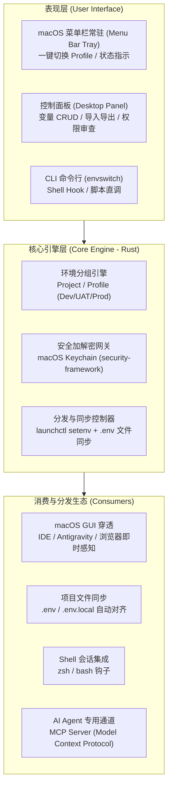

# EnvSwitch ⚡️

> **macOS 菜单栏极简环境变量与凭证管理中枢**
> *A lightweight macOS menu-bar app to manage environment variables & secrets, bridging the gap between GUI apps, terminal shells, and AI Agents.*

---

## 🌟 为什么需要 EnvSwitch？(Why EnvSwitch?)

在 macOS 上进行现代全栈开发与 AI Agent 协同编程时，开发者普遍面临四个痛苦断层：

1. **macOS GUI 与终端严重割裂 (The GUI vs. Shell Disconnect)**
   - 在终端 `export FOO=bar` 或写在 `~/.zshrc`，通过 Spotlight、Raycast 或 Finder 打开的 GUI 软件（如 **VS Code、Cursor、Antigravity、Chrome、Ego 浏览器**）其父进程是 `launchd`，**默认完全读不到这些环境变量**！
2. **多业务线与多环境爆炸 (Profile Sprawl)**
   - 同时负责多个项目（客户 A、客户 B、自研工具...），每个项目又细分 `Local / Dev / UAT / Prod`。
   - 不同的 URL、账号、Token、DB 密码混杂在几十个 `.env` 文件中，频繁手动复制极易串改或误连生产。
3. **敏感凭证泄漏风险 (Security Risk)**
   - 生产数据库密码、第三方 API Secret 常常直接以明文保存在 `.env` 中，极易被误加入 Git 提交或在录屏、截屏时泄露。
4. **AI Agent 时代缺乏统一凭证中枢 (Missing Link for AI Agents)**
   - 当让 AI Agent（如 Claude Code、Antigravity、Codex）排查生产日志或执行运维任务时，没有安全标准的凭证调取通道，只能反复在聊天窗口里手动明文复制粘贴密码。

---

## ✨ 核心特性 (Key Features)

- 🚀 **菜单栏极简快切 (Tray-First)**：常驻 macOS 顶部菜单栏，点击下拉即可 1 秒切换当前激活的项目与环境 Profile（如 `ProjectA-Dev` $\leftrightarrow$ `ProjectA-Prod`）。
- 🔌 **系统级 GUI 穿透 (System Injection)**：底层自动联动 `launchctl setenv`，无需重启电脑即可让全局 GUI 应用即时读取最新环境变量。
- 🔐 **macOS Keychain 硬件级保护**：敏感字段标记为 `Secret`，底层无缝落入系统钥匙串（macOS Keychain），UI 界面默认打码防窥，杜绝磁盘明文。
- 📁 **项目 `.env` 智能双向对齐**：选定本地代码仓库后，一键生成/切换 `.env.local`，自动校验 `.gitignore` 防误提，支持反向一键导入现有 `.env`。
- 🤖 **内置 MCP 协议服务 (AI Agent Bridge)**：原生支持 Model Context Protocol (MCP)，AI Agent 可通过安全工具接口按需、受控地申请环境凭证，杜绝提示词泄密。

---

## 🏗 系统架构 (Architecture)

---

## 🛠 技术栈 (Tech Stack)

- **框架**：[Tauri 2.0](https://v2.tauri.app/)（超轻量桌面框架，打包仅 ~8MB，内存仅 ~30MB）
- **核心逻辑**：Rust 2021（高性能、内存安全、macOS 原生 Keychain 与 launchd 绑定）
- **前端界面**：Vue 3 + TypeScript + Vite + Tailwind CSS
- **包管理器**：Bun / pnpm

---

## 🗺 路线图 (Roadmap)

### Phase 1：MVP 核心可用版
- [x] GitHub 仓库建立与 Tauri 2.0 + Vue 3 脚手架搭建
- [ ] 本地 SQLite 数据模型（Workspace / Project / Profile / Variables）
- [ ] macOS Keychain 原生密码存储集成
- [ ] macOS 菜单栏 Tray 基础交互与 Profile 秒切
- [ ] `launchctl setenv` 全局系统注入

### Phase 2：工程化与本地联动
- [ ] 项目本地目录绑定与 `.env` / `.env.local` 导出与反向解析
- [ ] `.gitignore` 自动安全检查（防误提泄露）
- [ ] 终端 Shell Hook（进入目录自动提示/切换）

### Phase 3：AI Agent 赋能
- [ ] 内置轻量 stdio / SSE 模式 MCP Server
- [ ] Agent 凭证调取弹窗授权与安全审计日志
- [ ] 变量引用与动态模板语法（如 `${DB_HOST}:${DB_PORT}`）

---

## 📄 开源许可证 (License)

[MIT License](LICENSE) © 2026 Jason Meng
